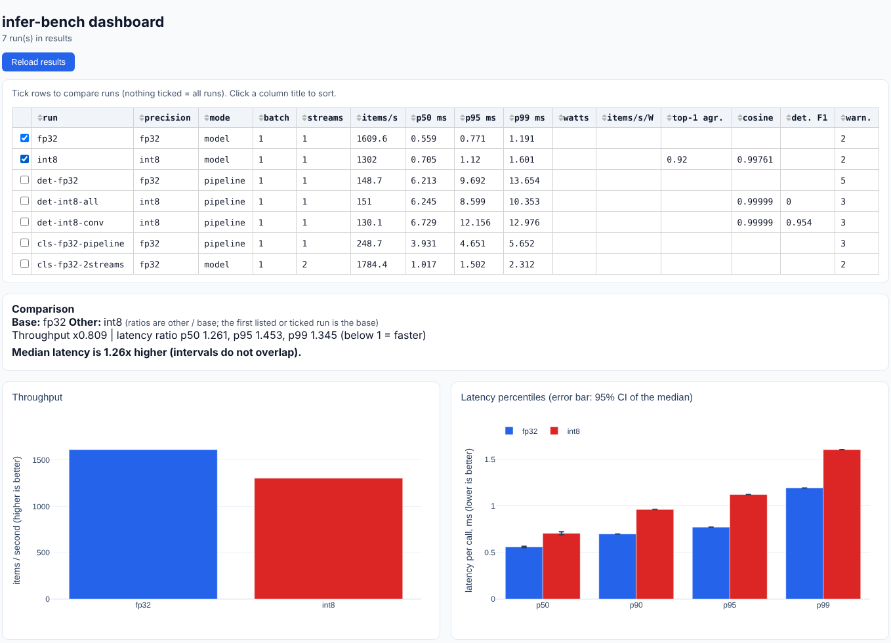

# infer-bench

A small, honest benchmarking harness for ML inference. It measures latency (percentiles with a confidence
interval), throughput, how much an INT8 model disagrees with its FP32 original, and (where the hardware allows)
power. Every result is saved as a JSON file that records *how* and *where* it was measured, and a dashboard
compares runs.



*The dashboard, on the demo models that ship with the tool (random weights, a small cloud VM). It shows the
format, not results worth quoting.*

> **Status.** Tested on Linux with Python 3.10, 3.11, 3.12 and 3.13, and with ONNX Runtime 1.18, 1.23, 1.29 and
> 1.31 (247 automated tests). Tried on the demo models and on real third-party models (PaddleOCR text models from
> the `rapidocr-onnxruntime` package), which is how most of the pitfalls described below were found.
> **Not tested:** Windows, macOS, GPUs or any execution provider other than the CPU, real RAPL power hardware (the
> counter code is tested against a fake `/sys` tree only), the Dockerfile, the GitHub Actions workflow, and
> anything on a real YOLO export. See [Limits](#limits).

## Why this exists

A latency number without its method and hardware is not a result. Typical ways it goes wrong: the first, slow
calls are included; one lucky run is quoted; the mean hides a bad tail; INT8 is assumed to be faster; an accuracy
loss is waved away with "cosine similarity 0.999". `infer-bench` is built around the opposite habits:

* **Honest timing.** Warm-up is discarded, every call is timed on its own, the garbage collector is paused,
  and the report gives p50/p90/p95/p99, the 95 % confidence interval of the median (block bootstrap) and plain-language
  warnings when a run drifted, was spiky, or had too few samples for its p99. A built-in `selfcheck` benchmarks a
  fake model of known latency to prove the harness itself is accurate on your machine.
* **Model vs. pipeline.** `--mode pipeline` times pre-processing, the model and post-processing separately,
  because the model is often not where the time goes (on the demo classifier, resizing and normalising the picture
  took three to four times longer than running the network).
* **Accuracy as agreement.** `quantize` makes an INT8 model; `accuracy` / `run --reference` measure how closely it
  follows the FP32 original (cosine, relative L2, top-1 agreement, detection F1). It is called *agreement*, not
  accuracy, because no labels are involved, and the tool says so in every result.
* **Diagnoses instead of silence.** The pitfalls met while testing (below) are detected and explained rather than
  producing a number that looks fine.
* **Reproducible.** One self-describing JSON per run: model SHA-256, configuration, CPU, software versions,
  warnings and the raw per-call latencies, so anyone can recompute the statistics.

## Install

Python 3.10 or newer. From the project folder:

```bash
python -m venv .venv
source .venv/bin/activate            # Windows: .venv\Scripts\activate
pip install -e ".[dashboard]"        # or ".[dev]" to also get pytest
```

`requirements-lock.txt` lists the exact versions the tests were last run with (Linux, Python 3.12).

## Quick start (two minutes, no model needed)

The commands below create two small demo models with *random weights*, benchmark them, quantise one to INT8 and
compare. Run them from the project folder; every command here was run as written.

```bash
infer-bench selfcheck                                   # is the harness accurate on this machine?
infer-bench demo-model classifier -o models/demo_classifier.onnx
infer-bench run models/demo_classifier.onnx --label fp32 --iterations 1000 --out results/fp32.json

infer-bench quantize models/demo_classifier.onnx -o models/demo_classifier_int8.onnx --samples 64
infer-bench run models/demo_classifier_int8.onnx --reference models/demo_classifier.onnx \
    --label int8 --iterations 1000 --out results/int8.json

infer-bench compare results/fp32.json results/int8.json
infer-bench summary results
infer-bench dashboard --results results                 # open http://127.0.0.1:8050
```

What the tool prints (shortened; numbers from the development sandbox, a 2-vCPU cloud VM; yours will differ):

```text
Run:        fp32
Model:      demo_classifier.onnx (fp32)   Backend: onnxruntime 1.29.0 ['CPUExecutionProvider']
Setup:      mode=model batch=1 streams=1 warmup=50 samples=1000 inputs=synthetic
Latency:    p50 0.559 ms (95% CI 0.551-0.566)   p90 0.697   p95 0.771   p99 1.191   max 8.947
            mean 0.614 +/- 0.396 ms   outliers 5.8%   drift -5.0% (stable)
Throughput: 1609.6 items/s   (1000 calls in 0.62 s)
Warnings:
  - 5.8% of the samples are outliers (spikes): check for background activity.
  - Synthetic inputs were used: fine for speed, not meaningful for accuracy.

$ infer-bench compare results/fp32.json results/int8.json
Base : fp32
Other: int8   (ratios are other / base)
Throughput ratio: 0.809x   (1609.6 -> 1302.0 items/s)
Latency ratio:    p50 1.261   p95 1.453   p99 1.345   (below 1 = faster)
Verdict: Median latency is 1.26x higher (intervals do not overlap).
Accuracy of 'int8' vs its reference: cosine 0.99761, top-1 agreement 0.920, detection F1 -
```

Note what happened: on this machine the INT8 model was **slower**, not faster (1.26x higher median latency here; a second,
identical run a few minutes later gave 1.16x, which is what run-to-run variation looks like). That is a normal outcome
for a tiny model on a CPU without good integer support, and exactly the kind of thing the tool exists to show. When two runs
cannot be told apart, `compare` says so ("within measurement noise: do not claim a difference") instead of
declaring a winner.

## Benchmark your own model

Put an ONNX model in `models/` (a fixed batch of 1 is fine; larger `--batch` sizes need a dynamic batch dimension). For an
image model with real pictures (`data/calib` for calibration, `data/val` for evaluation; use pictures that look like your real data):

```bash
M="--mean 0.485,0.456,0.406 --std 0.229,0.224,0.225"     # whatever normalisation your model expects

# speed, including resize + normalise + softmax, on real pictures
infer-bench run models/model.onnx --mode pipeline --task classification --images data/val $M \
    --label model-fp32 --iterations 1000 --out results/model-fp32.json

# INT8, calibrated on real pictures, then speed and agreement with the FP32 original
infer-bench quantize models/model.onnx -o models/model-int8.onnx --images data/calib --samples 100 $M
infer-bench run models/model-int8.onnx --reference models/model.onnx --images data/val $M \
    --label model-int8 --iterations 1000 --out results/model-int8.json

infer-bench compare results/model-fp32.json results/model-int8.json
```

(The commands above were run with the demo classifier standing in for `model.onnx` and a handful of real sample
pictures.) If a folder holds more pictures than `--max-images` or `--samples`, a random, seeded sample is used.

Getting a model (these steps need internet access and have **not been run or verified** as part of this project, so check
the options against the current documentation):

* Any ONNX export works. For torchvision classifiers, `torch.onnx.export` with `input_names=["images"]` and a
  dynamic batch axis; for Ultralytics YOLO, `yolo export model=yolov8n.pt format=onnx imgsz=640`.
* Mind the licences. YOLOv8 code and weights from Ultralytics are AGPL-3.0, so benchmark them on your machine but do not
  commit the `.pt` or `.onnx` files to a public repository (`models/*` and `*.onnx` are git-ignored here). Check the
  terms of any model you use before redistributing it.
* An exported YOLO model usually has a fixed input size and a fixed batch of 1, which is the default here.

### Detectors (YOLO-style output)

For a model whose output is `(1, 4 + classes, anchors)`, use `--task detection` in pipeline mode (letterbox resize,
confidence threshold, class-aware NMS). The demo detector shows why detection needs its own agreement metric:

```bash
infer-bench demo-model detector -o models/demo_detector.onnx
infer-bench quantize models/demo_detector.onnx -o models/demo_detector_int8_all.onnx --task detection --samples 64
infer-bench quantize models/demo_detector.onnx -o models/demo_detector_int8_conv.onnx --task detection --samples 64 --op-types Conv
infer-bench accuracy models/demo_detector.onnx models/demo_detector_int8_all.onnx  --task detection
infer-bench accuracy models/demo_detector.onnx models/demo_detector_int8_conv.onnx --task detection
```

Both INT8 models score a cosine similarity of 0.99999 against FP32. But the first (everything quantised) finds
**no objects at all** (detection F1 0.000) and the second (convolutions only) keeps almost all of them (F1 0.954).
Cosine similarity alone would have called both fine.

The same comparison as benchmark runs, which also fill the dashboard's "where the time goes" and "speed vs agreement" charts
(`--task detection` makes `run --reference` score boxes too):

```bash
infer-bench run models/demo_detector.onnx --mode pipeline --task detection --label det-fp32 --iterations 300 --out results/det-fp32.json
infer-bench run models/demo_detector_int8_conv.onnx --mode pipeline --task detection \
    --reference models/demo_detector.onnx --label det-int8-conv --iterations 300 --out results/det-int8-conv.json
```


## Lessons the tool encodes

Found while testing, documented in detail in [docs/METHODOLOGY.md](docs/METHODOLOGY.md#5-quantisation):

1. **A near-perfect cosine similarity can hide a broken model** (the detector above). Detection gets its own F1, and a
   detector-shaped output without a task gets a hint.
2. **Some exporters store weights as `Constant` nodes.** Depending on the ONNX Runtime version, quantisation then silently
   skips them and the "INT8" model is bigger and wrong. `quantize` warns about this, about unfolded
   BatchNorm layers, and about an output that is hardly smaller than its input.
3. **Old operator sets (< 13) and per-channel weights.** One ONNX Runtime version refuses with an error, another
   writes a file it cannot load. `quantize` picks per-tensor weights automatically for such models and reloads every
   file it writes, failing with a clear message instead of printing "Wrote ...".
4. **INT8 is not automatically faster, or good.** On the development VM the demo classifier was slower as INT8, a real
   OCR text detector was within noise, and a naively calibrated INT8 version of that detector collapsed to all-zero
   output on some images. Measure both speed and agreement.

## Power and energy

* **Linux, Intel or AMD:** RAPL energy counters give the CPU *package* power; an idle baseline is measured first, and
  energy per item and items/s per watt are reported both gross and net of idle. RAPL usually needs root, or
  `sudo chmod -R a+r /sys/class/powercap/intel-rapl*`. It does **not** cover the whole machine, a GPU or an accelerator
  card.
* **Anywhere:** `--power-watts 12.5 [--idle-watts 4.0]` takes numbers from a wall-socket meter; the result is labelled as
  user-supplied.
* The RAPL code was tested against a fake `/sys` tree (counter wrap-around, permissions, duplicate domains), not
  against real hardware.

## Results file and dashboard

One JSON file per run (`schema_version` 1.0, see [docs/METHODOLOGY.md](docs/METHODOLOGY.md#7-what-is-stored-and-reproducibility)):
model identity (SHA-256, size, precision, operators), backend and options, full configuration, environment, latency and
throughput, per-stage timings, streams, power, accuracy, warnings, and the raw per-call latencies. Folder names and the
Python path are deliberately **not** stored; still, glance through a file before publishing it.

`infer-bench summary results --format markdown` prints a table you can paste into a README; `--format csv` is there
for spreadsheets. `infer-bench dashboard` shows throughput, latency percentiles with confidence bars, the latency
distribution, latency over the run (to spot warm-up, drift and spikes), per-stage time, speed vs. agreement, and
efficiency. Ticking two rows gives a written comparison.

## Several streams

`--streams 4 --duration 5` runs four threads against one loaded model for a fixed time and reports total and
per-stream throughput. This models "several camera streams on one device" only roughly (Python threads, one
process); see the methodology notes.

## Extending: another runtime

The runner only talks to the small `Backend` interface in `infer_bench/backends/base.py` (`load`, `inputs`, `outputs`,
`run`, `describe`). A new runtime, for example a vendor accelerator's own Python API, means writing one subclass and
registering it in `backends/__init__.py`. **No such backend exists yet**; the only real one is ONNX Runtime (CPU by
default, other providers are passed through but untested, and an unavailable provider is refused rather than silently
replaced by the CPU).

## Development

```bash
pip install -e ".[dev]"
pytest                       # all tests (about 30 s)
pytest -m "not timing"       # skip the 8 tests that assert on wall-clock timing (use this on busy machines / CI)
```

```text
infer_bench/
  runner.py       the benchmark loop: warm-up, timed region, multi-stream, results document
  stats.py        percentiles, block-bootstrap CI, drift, outliers
  accuracy.py     agreement with a reference model (cosine, top-1, detection F1)
  quantize.py     ONNX Runtime static INT8 quantisation + diagnostics
  power.py        RAPL and manual power
  backends/       Backend interface, ONNX Runtime, a fake sleep backend for testing the harness
  preprocess.py, postprocess.py, inputs.py     pictures in, classes / boxes out
  results.py, compare.py, env.py, modelinfo.py  the results file, comparison, machine description
  figures.py, dashboard.py                     the Plotly Dash dashboard
  cli.py, demo_model.py
tests/            pytest suite (a fake RAPL tree, fake backends, tiny demo models)
docs/METHODOLOGY.md   what is measured, how, and where it can mislead
```

Dash 4 prints a notice that `dash_table` will move out of the core package in a future major version; `dash<5` is
pinned for that reason and the notice is silenced in the tests.

## Docker

A `Dockerfile` is included. TODO(you): build and test it (instructions at the top of the file) before you keep this
section; it has **not** been built yet. Inside a container, timing is noisier and RAPL is normally not visible.

## Limits

* One machine, one process; Python-side timing of a call into the runtime, not end-to-end latency of a camera pipeline.
* CPU timing only. GPU and other execution providers are passed through to ONNX Runtime but untested; host-to-device copies
  are inside the timed call.
* Agreement with a reference model is not accuracy: no labelled dataset, no mAP.
* The drift check compares the two halves of a run, so a slowdown covering only the last quarter or less is not caught
  (it appears as outliers and in p95/p99 instead).
* Not tested on Windows or macOS (console output is plain ASCII on purpose).
* Real-model behaviour was checked only on the PaddleOCR models named at the top; a YOLO or ResNet export has not been
  tried.

## Results on my machine

TODO(you): run the commands from "Benchmark your own model" on your own computer with a real model, then replace this
paragraph with the table that `infer-bench summary results --format markdown` prints, and list the machine
(`infer-bench env` shows CPU, cores, OS, Python and package versions), the model, where it came from and its licence.
Do not publish numbers you did not measure yourself. Result files are git-ignored except in `results/published/`:
copy the raw JSON files you want to share there.

## How this was built

TODO(you): this paragraph must be true before you publish. Suggested text, to edit: "This project was written with
substantial help from an AI coding assistant (Anthropic's Claude), which produced most of the code and tests. I read
and can explain every module, ran the commands in this README on my own machine, and take responsibility for what is
published here." Change it to match what you actually did, and delete this line.

## Licence

MIT, see [LICENSE](LICENSE).
