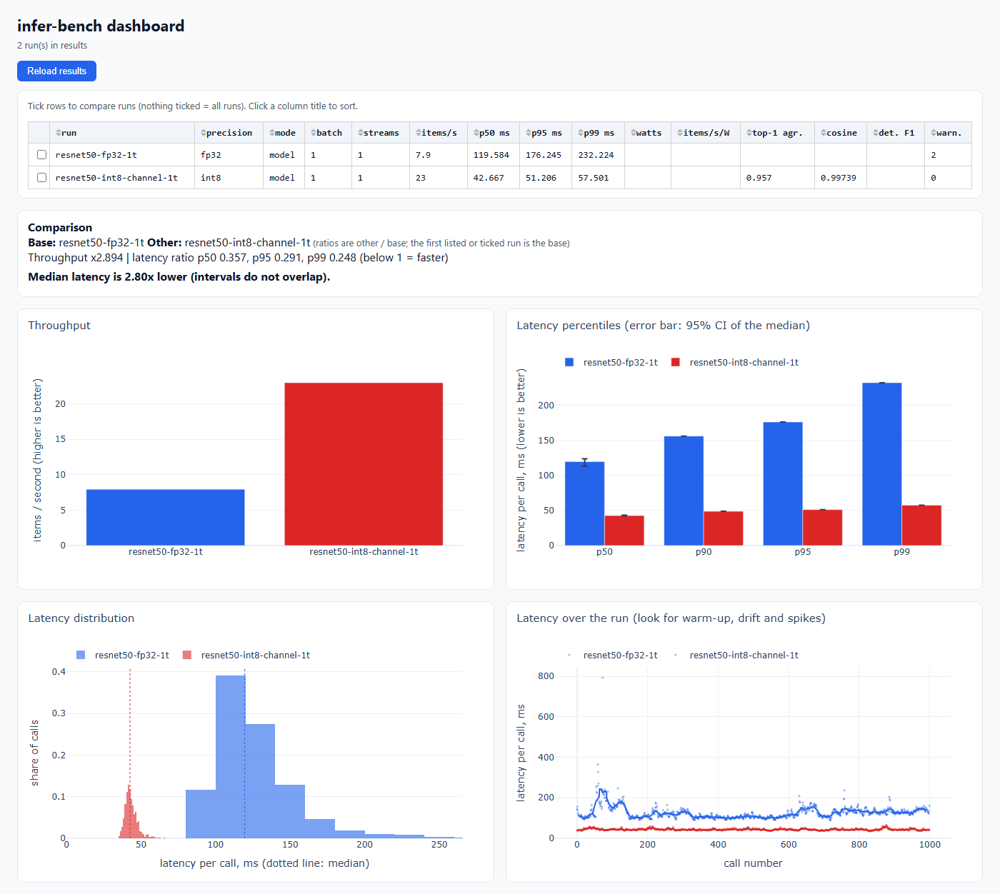
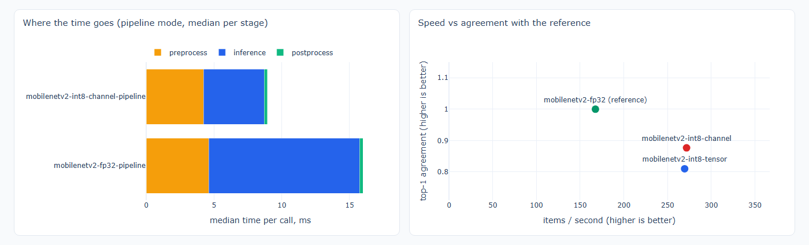
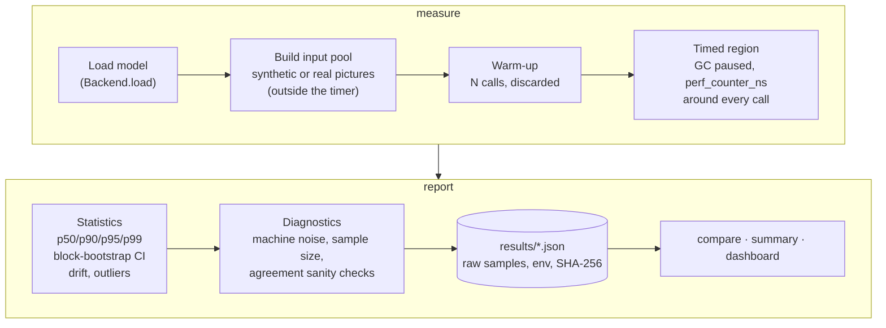
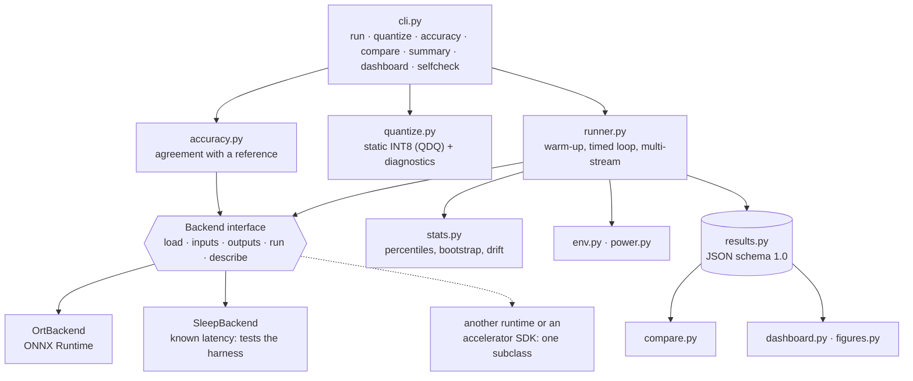

# infer-bench

[](https://github.com/Doufless1/infer-bench/actions/workflows/ci.yml)


**A benchmarking harness for ML inference that treats every number as a measurement, not a claim.**

It measures latency *distributions* (p50 to p99, with a confidence interval on the median), throughput, how far an
INT8 model drifts from its FP32 original, where the time goes in a full pre-process → model → post-process pipeline,
and power. Every run is saved as one self-describing JSON file (model hash, machine, settings, raw per-call
latencies), and the tool explains, in plain words, when a result should not be trusted.



*The dashboard comparing ResNet-50 FP32 with INT8 (single thread, real pictures; rows from the table below). With two
runs it writes the verdict itself. The timeline at the bottom right shows every one of the 1000 calls: FP32's
slow start and a single 800 ms stall stay visible instead of being averaged away.*

---

## Results on real models

Measured on my laptop: **Intel Core i5-1035G1** (Ice Lake, 4 cores / 8 threads, AVX-512 VNNI), Windows 11,
Python 3.12, ONNX Runtime 1.31 on the CPU, on mains power. Models: **MobileNetV2** and **ResNet-50 v1** from the
[ONNX Model Zoo](https://github.com/onnx/models) (Apache-2.0). Inputs: 300 real pictures from the validation split
of [Imagenette](https://github.com/fastai/imagenette) (10 ImageNet classes): speed on a pool of 64 of them, agreement
on all 300. The INT8 models were calibrated on 200 *different* pictures from the training split.

| model | precision | threads | p50 latency (95 % CI) | p99 | throughput | top-1 agreement | size |
|---|---|---|---|---|---|---|---|
| MobileNetV2 | FP32 | 4 | **5.89 ms** (5.76–6.01) | 13.4 ms | 167.5 /s | reference | 14.0 MB |
| MobileNetV2 | INT8 per-tensor | 4 | **3.54 ms** (3.41–3.68) | 7.83 ms | 269.5 /s | 81.0 % | 3.6 MB |
| MobileNetV2 | INT8 per-channel | 4 | **3.35 ms** (3.24–3.45) | 9.92 ms | 271.7 /s | 87.7 % | 3.8 MB |
| ResNet-50 | FP32 | 4 | **47.1 ms** (45.3–49.8) | 81.5 ms | 19.6 /s | reference | 102.6 MB |
| ResNet-50 | INT8 per-tensor | 4 | **16.7 ms** (16.2–17.1) | 32.2 ms | 58.6 /s | 93.3 % | 25.7 MB |
| ResNet-50 | INT8 per-channel | 4 | **17.1 ms** (16.7–17.5) | 90.7 ms | 46.7 /s | 95.7 % | 26.1 MB |
| MobileNetV2 | FP32 | 1 | **11.8 ms** (11.5–12.1) | 18.9 ms | 82.6 /s | reference | 14.0 MB |
| MobileNetV2 | INT8 per-channel | 1 | **5.33 ms** (5.24–5.47) | 8.58 ms | 177.6 /s | 87.7 % | 3.8 MB |
| ResNet-50 | FP32 | 1 | **119.6 ms** (113.2–123.7) | 232.2 ms | 7.9 /s | reference | 102.6 MB |
| ResNet-50 | INT8 per-channel | 1 | **42.7 ms** (42.2–43.4) | 57.5 ms | 23.0 /s | 95.7 % | 26.1 MB |

*Agreement = how often the INT8 model picks the same top-1 class as FP32 on the 300 pictures. It is not ImageNet
accuracy (no labels are used, see [Methodology](docs/METHODOLOGY.md#4-accuracy-it-is-agreement-not-accuracy)).
"per-tensor" / "per-channel" is how the INT8 weights are scaled. "4 threads" is ONNX Runtime's default here (one
thread per physical core); "1" is `--threads 1`. Every row is one JSON file in
[`results/published/`](results/published), raw latencies included.*

**Headline:** INT8 with per-channel weights is **2.8x faster** than FP32 on ResNet-50 (2.76x with 4 threads, 2.80x
with 1) and **1.8–2.2x faster** on MobileNetV2, while picking the same class as FP32 on 95.7 % and 87.7 % of the
pictures, at a quarter of the size. Every one of these speed-ups passed `compare`'s test: the 95 % confidence
intervals of the two medians do not overlap.

What the table shows that a single number would hide:

* **Throughput and the median can disagree.** The two ResNet-50 INT8 rows have almost the same p50 (16.7 vs 17.1 ms)
  but different throughput (58.6 vs 46.7 /s). The per-channel run had one 810 ms stall and 8.3 % outlier calls, and
  throughput counts every one of them. That is why both are reported.
* **More threads, fatter tail.** With 4 threads ONNX Runtime splits each operator across the cores, and one thread
  that the OS deschedules holds up the whole operator. MobileNetV2 INT8's p99 is 3.0x its median with 4 threads and
  1.6x with 1 thread.
* **Four cores are not four times one core.** One 1-thread stream: 178 items/s. One 4-thread stream: 272 items/s.
  Four 1-thread streams (`--streams 4`): 271 items/s in total, 64–73 per stream, each call taking 13.1 ms instead of
  5.3 ms. Splitting the work differently does not raise the total on this 15 W laptop chip; most likely the shared
  power budget lowers the clock when all four cores are busy (clock speeds were not measured).
* The tool flagged more than 5 % drift on several runs (a laptop with a browser, antivirus and WSL in the background).
  The warnings are stored in each JSON file; the speed-ups are far larger than that noise.

## What it found

### 1. Per-tensor INT8 breaks MobileNetV2, and the fix is an opset number

Both Model Zoo files use ONNX **operator set 12**. Per-channel INT8 weights need a `DequantizeLinear` with an `axis`
attribute, which only exists from opset 13, so `quantize` falls back to one scale per weight tensor (and says so).
For ResNet-50 that costs little. For MobileNetV2 it is severe: its depthwise convolutions have per-channel weight
ranges that differ by orders of magnitude, and one shared scale flattens the small channels.

| MobileNetV2 → INT8 (MinMax calibration) | size | cosine to FP32 | top-1 agreement | FP32 top-1 in INT8 top-5 |
|---|---|---|---|---|
| opset 12, per-tensor weights (what you get by default) | 3.60 MB | 0.9531 | **81.0 %** | 98.0 % |
| opset converted to 13, per-channel weights | 3.83 MB | 0.9789 | **87.7 %** | 100.0 % |
| same, percentile calibration | 3.83 MB | 0.9826 | 87.7 % | 100.0 % |

ResNet-50 goes from 93.3 % to 95.7 % with the same change. The conversion is a graph rewrite with
`onnx.version_converter`: no retraining, no re-export, and the converted FP32 model gives the same outputs as the
original (relative L2 error 0.00000 on 100 pictures, checked with `infer-bench accuracy`). It is shown in
[Reproduce](#reproduce-the-real-model-results).

### 2. ONNX Runtime's "entropy" calibration is MinMax in disguise

`--method entropy` and `--method minmax` produced **byte-identical** MobileNetV2 files (same SHA-256); the entropy run
just took 282 s instead of 15 s. The cause is in ONNX Runtime: `quantize_static` builds the entropy histogram with
128 bins and searches it with 128 quantised bins, and exposes no option to change either. The KL-divergence search
loops over `range(num_quantized_bins // 2, num_bins // 2 + 1)`, which is `range(64, 65)`: a single candidate
threshold, the full min/max range.

I then ran a real entropy search (2048 bins, the ranges injected through ONNX Runtime's `TensorQuantOverrides`). It
made MobileNetV2 *worse* (83.7 % agreement vs 87.7 % for MinMax), so the tool does not re-implement the calibrator: it
**warns** that entropy equals MinMax, and a test pins ONNX Runtime's behaviour so the warning is flagged if a future
release changes it.

### 3. Cosine similarity 0.99999, and the detector finds nothing

On the demo detector (YOLO-style output, random weights), quantising every operator gives a model whose raw output
has a cosine similarity of 0.99999 to FP32, and which finds **no objects at all** (detection F1 0.000: 0 boxes, against 219 from FP32). The
output tensor mixes pixel-scale box coordinates with 0–1 class scores; sharing one INT8 scale rounds every score to
zero. Quantising only the convolutions (`--op-types Conv`) keeps the detections (F1 0.954, 217 boxes). This is why
detection gets its own box-level F1, and why a detector-shaped output without `--task detection` gets a hint.

### 4. The model is not the pipeline

`--mode pipeline` times the work around the model as well, on the same pictures: resize to 224×224 and ImageNet
normalisation before the model, softmax and top-5 after it.

| MobileNetV2, 4 threads | pre-process | model | post-process | total (p50) | throughput |
|---|---|---|---|---|---|
| FP32 | 4.61 ms | 11.12 ms | 0.26 ms | 16.19 ms | 53.7 /s |
| INT8 per-channel | 4.22 ms | 4.48 ms | 0.23 ms | 9.03 ms | 107.5 /s |

INT8 made the model 2.5x faster but the whole pipeline only 1.8x faster, because pre-processing now takes as long as
the model. Amdahl's law gives the ceiling: even if the model took no time at all, this pipeline would top out at
1 / (4.22 + 0.23) ms ≈ **225 pictures/s per host thread**, only 2.1x today's rate. Put the network on an accelerator
that runs it many times faster than a CPU and the host-side resize and normalise become the bottleneck, which is why
the tool reports the stages separately instead of one end-to-end number. (The model stage is slower here than in
model-only mode, 4.48 vs 3.35 ms, probably because pre-processing pushes the model's data out of the CPU caches
between calls.)



*Two dashboard panels for MobileNetV2: where the time goes in pipeline mode (left), and speed against agreement with
FP32 for the per-tensor and per-channel INT8 models (right).*

### 5. It caught my own bad run

My first real-model run happened with the laptop unplugged. Every result file recorded `on_battery: true`, the CPU
was already 86–100 % busy when some runs started, and the medians drifted by up to 27 % between the first and
second half of a run. The tool printed all three warnings; those runs were thrown away and repeated on mains
power. Without the environment block and the drift check, they would have looked like ordinary numbers.

---

## How a number is produced



* **Every call is timed on its own** with `time.perf_counter_ns()`; picking the input and storing the sample happen
  outside the stopwatch. Warm-up calls are thrown away and Python's garbage collector is paused during the timed
  region.
* **Percentiles, not the mean.** The mean hides the tail, and the tail is what a real-time system has to survive.
* **A confidence interval for the median, by moving-block bootstrap.** Consecutive latencies are correlated (one
  busy moment slows several calls in a row), so an ordinary bootstrap gives intervals that are too narrow. Blocks of
  about n^(1/3) consecutive samples keep that correlation. `compare` only calls a difference real when the two
  intervals do not overlap; otherwise it says "within measurement noise: do not claim a difference".
* **Drift and outliers are reported, never hidden.** First-half vs second-half median catches throttling and
  background jobs; Tukey fences count spikes, and nothing is ever removed from the raw samples.
* **The harness checks itself.** `infer-bench selfcheck` benchmarks a fake backend that busy-waits a known 1 ms and
  5 ms. On the laptop above it measured **1.0018 ms** and **5.0047 ms** (timer resolution 100 ns).
* **Model vs pipeline.** `--mode pipeline` times pre-processing (resize, normalise), the model and post-processing
  (softmax/top-5, or YOLO decode + NMS) separately, on real pictures.
* **Accuracy is called agreement.** No labels are involved, so the tool compares INT8 against FP32 (cosine, relative
  L2, top-1/top-5 agreement, detection F1) and says that in every result.

The full reasoning, every warning and its blind spots are in [docs/METHODOLOGY.md](docs/METHODOLOGY.md).

## Architecture and design decisions



* **One small interface between the harness and the runtime.** The runner only knows `load`, `inputs`, `outputs`,
  `run` and `describe`. ONNX Runtime is one implementation; supporting another runtime, such as an accelerator
  vendor's Python SDK, means writing one subclass and touching nothing else. No such backend exists in this
  repository yet.
* **A fake backend as the test oracle.** `SleepBackend` takes an exactly known time per call, so the measurement code
  itself can be tested: if a 2 ms backend is reported as 2.3 ms, the bug is in the harness.
* **Fail loudly instead of degrading silently.** An unavailable execution provider is refused (ONNX Runtime would
  quietly fall back to the CPU and you would publish CPU numbers as GPU numbers). Every INT8 file `quantize` writes
  is loaded back before it reports success. A model whose opset cannot take per-channel weights is quantised per
  tensor, with a note, instead of producing a file that cannot be loaded.
* **Results are data, not screenshots.** Each JSON carries the model's SHA-256, the full configuration, CPU, OS and
  package versions, the warnings and the raw per-call latencies, so anyone can recompute the statistics. Host name,
  user name and folders are deliberately not stored.
* **Statistics without a statistics library.** `stats.py` is plain NumPy with no dependency on the rest of the
  package, which keeps it easy to test in isolation; the bootstrap is seeded, so the same file always gives the
  same interval.
* **Few dependencies.** NumPy, ONNX, ONNX Runtime, Pillow and psutil; Dash and Plotly only for the dashboard. Console
  output is plain ASCII so it prints correctly in any Windows code page.
* **Tested like a measuring instrument.** 248 tests cover the percentile and bootstrap maths, drift and outlier
  detection, the timed loop against known latencies, multi-stream fairness and failure handling, RAPL counter
  wrap-around on a fake `/sys` tree, quantisation of opset-12 models, the entropy finding above, results validation and
  the dashboard. CI runs them on Linux (Python 3.10–3.13) and Windows, and builds the Docker image.

## Quick start

Python 3.10 or newer.

```bash
python -m venv .venv
source .venv/bin/activate            # Windows: .venv\Scripts\activate
pip install -e ".[dashboard]"        # or ".[dev]" to also get pytest
```

No model needed for a first look: the tool can write two small demo models with random weights.

```bash
infer-bench selfcheck                                   # is the harness accurate on this machine?
infer-bench demo-model classifier -o models/demo_classifier.onnx
infer-bench run models/demo_classifier.onnx --label fp32 --iterations 1000 --out results/fp32.json

infer-bench quantize models/demo_classifier.onnx -o models/demo_classifier_int8.onnx --samples 64
infer-bench run models/demo_classifier_int8.onnx --reference models/demo_classifier.onnx \
    --label int8 --iterations 1000 --out results/int8.json

infer-bench compare results/fp32.json results/int8.json
infer-bench dashboard --results results                 # http://127.0.0.1:8050
```

What a run prints (the single-thread ResNet-50 INT8 run from the table above), and a comparison:

```text
$ infer-bench run models/resnet50-int8-channel.onnx --images data/val $M --threads 1 --iterations 1000 \
      --reference models/resnet50-v1-12.onnx --accuracy-samples 300 --label resnet50-int8-channel-1t
Run:        resnet50-int8-channel-1t
Model:      resnet50-int8-channel.onnx (int8)   Backend: onnxruntime 1.31.0 ['CPUExecutionProvider']
Setup:      mode=model batch=1 streams=1 warmup=50 samples=1000 inputs=images
Latency:    p50 42.667 ms (95% CI 42.220-43.354)   p90 48.788   p95 51.206   p99 57.501   max 65.826
            mean 43.474 +/- 4.224 ms   outliers 3.7%   drift -1.9% (stable)
Throughput: 23.0 items/s   (1000 calls in 43.48 s)
Power:      not measured (no /sys/class/powercap (RAPL is Linux-only, on Intel or AMD CPUs). Use --power-watts ...)
Accuracy:   vs reference (300 samples, images): cosine 0.99739   top-1 agreement 95.7%

$ infer-bench compare results/published/resnet50-fp32-1t.json results/published/resnet50-int8-channel-1t.json
Throughput ratio: 2.894x   (7.9 -> 23.0 items/s)
Latency ratio:    p50 0.357   p95 0.291   p99 0.248   (below 1 = faster)
Verdict: Median latency is 2.80x lower (intervals do not overlap).
Accuracy of 'resnet50-int8-channel-1t' vs its reference: cosine 0.99739, top-1 agreement 0.957, detection F1 -
```

## Reproduce the real-model results

The models, pictures and quantised files are not in the repository (size and licences); these commands recreate
them. Downloads: about 14 MB + 98 MB of models and 94 MB of pictures.

```bash
mkdir -p data && cd data
curl -LO https://github.com/onnx/models/raw/main/validated/vision/classification/mobilenet/model/mobilenetv2-12.onnx
curl -LO https://github.com/onnx/models/raw/main/validated/vision/classification/resnet/model/resnet50-v1-12.onnx
curl -LO https://s3.amazonaws.com/fast-ai-imageclas/imagenette2-160.tgz && tar -xzf imagenette2-160.tgz
cd .. && mv data/*.onnx models/
```

Then make the calibration set (20 pictures per class from `train`) and the evaluation set (30 per class from `val`)
with the same seeded script used for the published results, and run:

```bash
python scripts/imagenette_sets.py data/imagenette2-160 data    # -> data/calib (200), data/val (300), no overlap
M="--mean 0.485,0.456,0.406 --std 0.229,0.224,0.225"     # ImageNet normalisation

# opset 12 -> 13, so that per-channel INT8 weights are possible (a graph rewrite, no retraining)
python -c "import onnx, onnx.version_converter as v; onnx.save(v.convert_version(onnx.load('models/mobilenetv2-12.onnx'), 13), 'models/mobilenetv2-13.onnx')"

infer-bench quantize models/mobilenetv2-12.onnx -o models/mobilenetv2-int8-tensor.onnx  --images data/calib --samples 200 $M
infer-bench quantize models/mobilenetv2-13.onnx -o models/mobilenetv2-int8-channel.onnx --images data/calib --samples 200 $M
infer-bench accuracy models/mobilenetv2-12.onnx models/mobilenetv2-int8-channel.onnx --images data/val --samples 300 $M

infer-bench run models/mobilenetv2-12.onnx --images data/val $M --label mobilenetv2-fp32 --iterations 2000 \
    --out results/published/mobilenetv2-fp32.json
infer-bench run models/mobilenetv2-int8-channel.onnx --images data/val $M --label mobilenetv2-int8-channel \
    --iterations 2000 --reference models/mobilenetv2-12.onnx --accuracy-samples 300 \
    --out results/published/mobilenetv2-int8-channel.json
# the other rows: --threads 1 for single-thread, --mode pipeline --task classification for the stage breakdown,
# --streams 4 --duration 10 for several streams
infer-bench summary results/published --format markdown
```

ResNet-50 is the same with `resnet50-v1-12.onnx` (1000 iterations is enough at its speed).

## Benchmark your own model

Any ONNX model works. A fixed batch of 1 is fine; larger `--batch` sizes need a dynamic batch dimension.

```bash
infer-bench info models/model.onnx                        # inputs, outputs, opset, operators, SHA-256
infer-bench run models/model.onnx --mode pipeline --task classification --images data/val $M \
    --label model-fp32 --iterations 1000 --out results/model-fp32.json
infer-bench quantize models/model.onnx -o models/model-int8.onnx --images data/calib --samples 100 $M
infer-bench run models/model-int8.onnx --reference models/model.onnx --images data/val $M \
    --label model-int8 --iterations 1000 --out results/model-int8.json
infer-bench compare results/model-fp32.json results/model-int8.json
```

For a YOLO-style detector (output `(1, 4 + classes, anchors)`) use `--task detection`: letterbox resize, confidence
threshold and class-aware NMS in pipeline mode, and box-level F1 in the agreement check. Calibrate on pictures that
look like your real data, never on random noise. Mind model licences: Ultralytics YOLOv8 weights are AGPL-3.0, so
benchmark them locally but do not commit them (`*.onnx` is git-ignored here).

| Command | What it does |
|---|---|
| `run` | benchmark a model (model or pipeline mode, batch, streams, threads, real pictures, power, agreement) and save a JSON |
| `quantize` | static INT8 (QDQ) with MinMax / percentile calibration, per-channel when the opset allows, `--op-types`, `--exclude-nodes`, and diagnostics |
| `accuracy` | agreement of a candidate model with a reference: cosine, relative L2, top-1/top-5, detection F1 |
| `compare` | ratios of two runs, a verdict that respects the confidence intervals, and warnings when the setups differ |
| `summary` | table of every run in a folder (text, Markdown or CSV) |
| `dashboard` | Plotly Dash app over a results folder; tick two runs for a written comparison |
| `info` / `env` | describe a model / the machine, software and power-meter status |
| `selfcheck` | prove the harness's own timing on this machine |
| `demo-model` | write a small demo classifier or detector (random weights) |

## Power, energy and several streams

* **Linux, Intel or AMD:** RAPL energy counters give CPU *package* power. An idle baseline is measured first, and
  energy per item and items/s per watt are reported both gross and net of idle (CPU package only, not the whole
  machine or an accelerator card). RAPL usually needs root or `sudo chmod -R a+r /sys/class/powercap/intel-rapl*`.
* **Anywhere:** `--power-watts 12.5 [--idle-watts 4.0]` takes a wall-meter reading; the result says it was supplied
  by the user. Windows has no RAPL, so the numbers above have no power figures.
* **Several streams:** `--streams 4 --duration 5` runs four threads against one loaded model for a fixed window and
  reports total and per-stream throughput, a rough model of several camera streams on one device (Python threads,
  one process; pre- and post-processing share the GIL, and the tool warns about it).

## Development

```bash
pip install -e ".[dev]"
pytest                       # all 248 tests, about 40 s
pytest -m "not timing"       # skip the 8 tests that assert on wall-clock time (busy machines, CI)
```

```text
infer_bench/
  runner.py       the benchmark loop: warm-up, timed region, multi-stream, results document
  stats.py        percentiles, block-bootstrap CI, drift, outliers
  accuracy.py     agreement with a reference model (cosine, top-1, detection F1)
  quantize.py     ONNX Runtime static INT8 quantisation + diagnostics
  power.py        RAPL and manual power
  backends/       Backend interface, ONNX Runtime, a fake sleep backend for testing the harness
  preprocess.py, postprocess.py, inputs.py     pictures in, classes / boxes out
  results.py, compare.py, env.py, modelinfo.py  the results file, comparison, machine description
  figures.py, dashboard.py                     the Plotly Dash dashboard
  cli.py, demo_model.py
tests/            pytest suite (a fake RAPL tree, fake backends, tiny demo models)
scripts/          imagenette_sets.py: the calibration / evaluation pictures for the README results
docs/METHODOLOGY.md   what is measured, how, and where it can mislead
```

A `Dockerfile` is included; CI builds it and runs a short benchmark inside it. Timing inside a container is noisier,
and RAPL is normally not visible there.

## Limits

* CPU only so far. Other ONNX Runtime execution providers are passed through but untested, and host-to-device copies
  would sit inside the timed call.
* Agreement with a reference model is not accuracy: no labelled dataset, no mAP.
* One process, Python-side timing of a call into the runtime; not the end-to-end latency of a camera pipeline.
* The drift check compares two halves of a run, so a slowdown confined to the last quarter shows up only in the
  outliers and p95/p99.
* Tested on Linux and Windows 11, not macOS. Real-model results come from one laptop; the RAPL code is tested against
  a fake `/sys` tree, not real hardware.

## Licence

MIT, see [LICENSE](LICENSE). The ONNX Model Zoo models are Apache-2.0; Imagenette is a subset of ImageNet, so check
its terms before redistributing pictures (none are in this repository).
